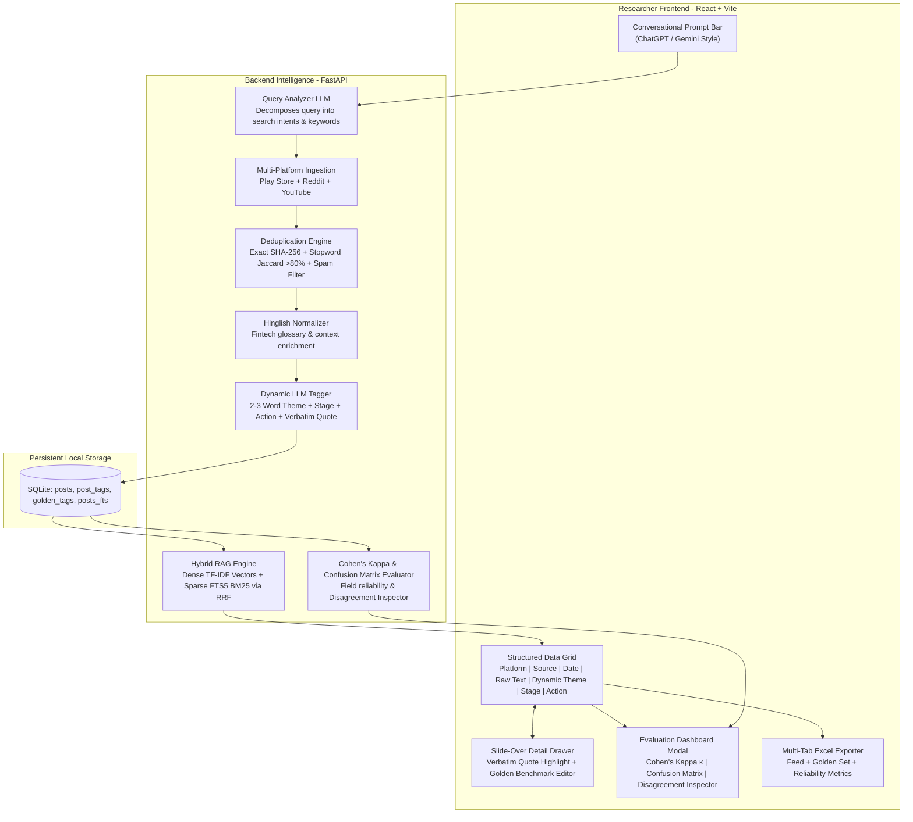

# SIP & Fintech Investor Behavior Discovery Engine

An open-ended, AI-powered qualitative research workbench for Product Managers, UX researchers, and fintech strategists studying retail investor behavior across Indian mutual fund and Systematic Investment Plan (SIP) platforms (**Groww**, **Zerodha Coin**, **Angel One**, **INDmoney**, and **Paytm Money**).

---

## 🌟 Core Philosophy & Design

Unlike conventional tools that constrain researchers to pre-determined problem categories or rigid dropdown filters, the **SIP Discovery Engine** features a **conversational, prompt-driven research space** inspired by modern LLM assistants (ChatGPT / Gemini / Perplexity):

1. **Conversational Prompt Interface**: Researchers enter natural language questions (e.g. *"Why do beginners stop SIPs during market downturns?"*, *"What friction occurs when moving from Groww to Zerodha Coin?"*, or *"Why do users cancel instead of pause?"*).
2. **Dynamic, Comment-Dependent Tagging**: Comments are never forced into static buckets. An LLM reads each raw comment and derives:
   * **Dynamic Theme**: Concise **2–3 word tag** describing the specific friction directly from context (e.g. *Market dip anxiety*, *Autopay bounce penalty*, *SOA vs Demat switch*, *Missing pause option*, *Units allocation delay*).
   * **Dynamic Journey Stage**: Inferred stage (e.g. *Onboarding / KYC*, *1st Month Beginner*, *Months 2-6 Market Dip*, *Year 2+ Experienced*, *Platform Migration*, *Exit / Withdrawal*).
   * **Dynamic Action Taken**: Inferred action (e.g. *Cancelled SIP*, *Paused indefinitely*, *Switched Platform*, *Continued despite dip*, *Seeking forum advice*).
   * **Verbatim Evidence Quote**: Exact substring copied word-for-word from raw text (`assert evidence_quote in raw_text`).
3. **Hybrid RAG Semantic Retrieval**: Fuses dense semantic vector embeddings with sparse SQLite FTS5 BM25 lexical search via **Reciprocal Rank Fusion (RRF)** to retrieve semantically relevant feedback even without literal keyword overlap.
4. **Active Reliability & Evaluation Suite**: Quantitative benchmarking measuring **Cohen's Kappa ($\kappa$)** chance-adjusted agreement, an interactive **Confusion Matrix**, and a **Disagreement Inspector** for auditing AI predictions against PM Golden Truth hand-labels.
5. **Executive Multi-Tab Excel Export**: Generates professional spreadsheets with 3 formatted tabs: *Active Research Feed*, *Golden Benchmark Set*, and *Reliability & Kappa Metrics*.

---

## 🏛️ System Architecture



---

## 🚀 Quick Start Guide

### 1. One-Click Launch (Recommended)

Run the included master launch script from the project root:

```bash
chmod +x run.sh
./run.sh
```

This script automatically verifies dependencies, initializes the SQLite database, launches the FastAPI backend on port `8000`, and launches the Vite frontend on port `5173`.

### 2. Manual Startup

**Terminal 1 — Backend (FastAPI):**
```bash
# Activate virtual environment
source backend/venv/bin/activate

# Start API server with auto-reload
python3 -m uvicorn backend.main:app --host 127.0.0.1 --port 8000 --reload
```

**Terminal 2 — Frontend (React / Vite):**
```bash
cd frontend

# Install node modules if first run
npm install

# Start Vite dev server
npm run dev -- --host 127.0.0.1 --port 5173
```

Access the application:
* **Research Workbench UI**: [http://127.0.0.1:5173](http://127.0.0.1:5173)
* **API Documentation**: [http://127.0.0.1:8000/docs](http://127.0.0.1:8000/docs)
* **Evaluation Metrics**: [http://127.0.0.1:8000/api/evaluation/metrics](http://127.0.0.1:8000/api/evaluation/metrics)

---

## 🔑 LLM Configuration (Optional)

The engine includes a built-in **dynamic heuristic NLP tagger** that operates locally and without cost.

To enable generative inference and query strategy powered by **Google Gemini 2.5 Flash**:
1. Click the **LLM Settings** button in the top navigation bar of the UI.
2. Enter your free Google AI Studio API key (`AIzaSy...`).
3. Click **Save Key**. The key is stored in your active session environment.

Alternatively, set it in `backend/.env`:
```env
GEMINI_API_KEY="your-google-ai-studio-key-here"
```

---

## 📊 Evaluation & Model Reliability Suite

Click the **Golden Benchmark (κ)** button in the top navigation bar to access the active evaluation suite:

* **Cohen's Kappa ($\kappa$)**: Measures inter-annotator agreement above random chance:
  $$\kappa = \frac{P_o - P_e}{1 - P_e}$$
  * Current benchmark reliability: **$\kappa = 0.665$ ("Substantial Agreement")** on the Landis & Koch scale.
  * Field breakdown: Theme ($\kappa = 0.955$), Fixer ($\kappa = 0.925$), Stage ($\kappa = 0.587$), Action ($\kappa = 0.193$).
* **Interactive Confusion Matrix**: Heatmapped grid cross-tabulating Golden Truth vs AI predictions to identify which categories the model confuses.
* **Disagreement Inspector**: Side-by-side audit cards showing where AI prediction diverged from Golden Truth hand-labels, with one-click **"Accept AI Prediction"** or **"Keep Golden Benchmark"** resolution buttons.

---

## 📥 Multi-Tab Excel Export

Click **Download Excel** in the workbench to generate an executive `.xlsx` file formatted with `openpyxl`:

1. **Sheet 1 — Active Research Feed**: Filtered and semantically ranked posts matching the active query (Platform, Source, Date, Raw Feedback, Dynamic Theme, Journey Stage, Action Taken, Persona, Responsible Entity, Verbatim Quote, Link).
2. **Sheet 2 — Golden Benchmark Set**: All hand-verified golden benchmark records with PM rationales and notes.
3. **Sheet 3 — Reliability & Kappa Metrics**: Complete statistical summary of Cohen's Kappa score, observed agreement rates, and field-level accuracies.

---

## 🛠️ Tech Stack

* **Frontend**: React 18, Vite, Lucide Icons, Pure CSS (Tailored dark mode, Google Stitch inspired tokens).
* **Backend**: FastAPI, Uvicorn, Pydantic, Python 3.9+.
* **NLP & Information Retrieval**: scikit-learn (TF-IDF sublinear vectorizer, Cohen's Kappa), SQLite FTS5 (BM25), Google GenAI SDK.
* **Ingestion**: `google-play-scraper`, `youtube-comment-downloader`, public Reddit Atom/RSS feeds.
* **Database & Export**: SQLite (`posts`, `post_tags`, `golden_tags`, `posts_fts`), `pandas`, `openpyxl`.

---

## 📄 License & Attribution
NestLeap Graduation Project — Qualitative Investor Discovery Engine.
Developed with Google DeepMind Antigravity Pair-Programming.
