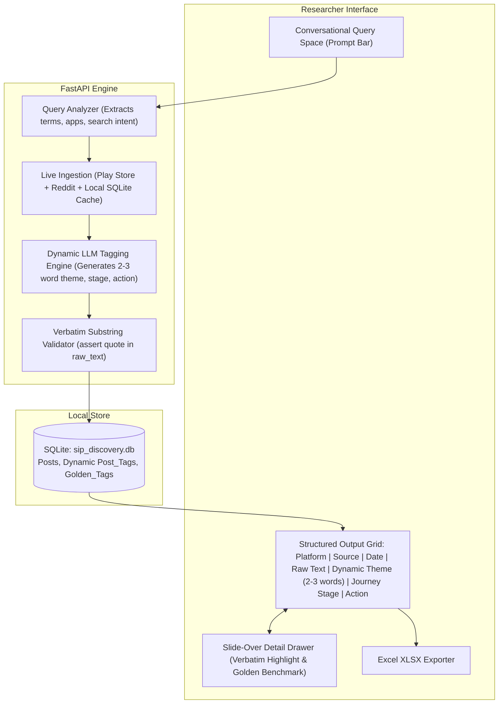

# Technical Architecture: SIP & Fintech Investor Discovery Engine

## 1. System Overview & Conversational Architecture

The SIP Discovery Engine is an open-ended research workbench designed for Product Managers studying investor behavior across all Indian fintech platforms (Groww, Zerodha Coin, Angel One, INDmoney, Kuvera, Paytm Money).

Rather than forcing research into pre-determined taxonomies or rigid categorical filters, the system operates as a **prompt-driven discovery engine**:
1. **Researcher Prompt**: The PM enters an open-ended research question into a clean query space (similar to ChatGPT or Gemini).
2. **Query Analysis**: An LLM decomposes the research question into search intents, target investment platforms, and semantic search keywords.
3. **Targeted Ingestion**: Free public scrapers query Google Play Store (app reviews) and Reddit (`r/IndiaInvestments`, `r/Mutualfunds`) using the generated search parameters.
4. **Dynamic Comment-Dependent Tagging**: An LLM reads each raw comment and dynamically tags:
   * **Platform**: e.g., Groww, Zerodha, Angel One, General MF.
   * **Source**: Google Play Store, Reddit, YouTube.
   * **Date**: Original publication timestamp.
   * **Raw Comment**: Full verbatim user comment.
   * **Theme**: Dynamic **2–3 word tag** describing the core problem or friction, completely derived from the text (not fixed).
   * **Journey Stage**: Dynamic investor stage derived from context (not fixed).
   * **Action Taken**: Dynamic investor action (not fixed).
   * **Evidence Quote**: Exact verbatim substring grounding the tags.



---

## 2. Ingestion Engine & Free Data Sources

### 2.1 Multi-App Google Play Store Ingestion
* **Target Platforms**: Groww (`com.nextbillion.groww`), Zerodha Coin (`com.zerodha.coin`), Angel One (`com.msf.angelmobile`), INDmoney (`in.indwealth`), Paytm Money (`com.paytmmoney`).
* **Query-Driven Scraping**: When a query is submitted, the LLM generates 3–5 targeted keyword variants (e.g. *"market crash"*, *"loss"*, *"SIP pause"*, *"SOA demat"*) and queries Play Store 1–3 star reviews matching those terms using `google-play-scraper`.
* **Typed Architecture & Failover**: Uses typed `CuratedReview` structures. If network rate-limits or drops, automatically falls back to curated local archives without crashing.

### 2.2 Reddit Ingestion
* **Target Subreddits**: `r/IndiaInvestments`, `r/Mutualfunds`, `r/personalfinanceindia`.
* **Execution**: Searches Reddit public feeds using query-aligned terms. If rate-limited or blocked, seamlessly falls back to authentic stored records.

### 2.3 YouTube Comment Ingestion
* **Fintech Channels**: Asset Yogi, CA Rachana Ranade, Labor Law Advisor, Smart Investor, Pranjal Kamra.
* **Extraction**: Dynamic video discovery via `youtube-comment-downloader` targeting retail investor tutorials on SIP cancellation, autopay mandate failures, bank bounce charges, and market panic.

### 2.4 Multi-Tier Deduplication & Hinglish Normalizer
* **Spam & Ad Filtering**: Automatically strips promotional Telegram crypto/forex signals, WhatsApp investment groups, and advisory spam.
* **Fuzzy Jaccard Overlap**: Drops duplicate cross-posts exceeding 80% token similarity after stripping stopwords.
* **Hinglish Normalizer**: Resolves colloquial Hindi-English fintech terminology (*"paisa cut gaya"*, *"units allocate nahi hue"*, *"mandate bounce"*, *"sip band kaise kare"*) into normalized contextual hints for sharp dynamic tagging.

### 2.5 Privacy & Synthetic Identifiers
* User handles, phone numbers, and emails are stripped (`[REDACTED_USER]`, `[REDACTED_PHONE]`).
* Posts receive synthetic identifiers (e.g., `POST_GROWW_D3A82`).

---

## 3. Dynamic LLM Tagging & Grounding Engine

The LLM enriches each post dynamically without restrictive categorical enums:

```json
{
  "theme": "string (Dynamic 2-3 words tagging the core problem/friction, derived directly from the comment)",
  "journey_stage": "string (Dynamic investor stage inferred from context, e.g. '1st Month Bull Run', 'Year 2 Market Dip', 'KYC Onboarding')",
  "what_they_did": "string (Dynamic action taken, e.g. 'Cancelled SIP', 'Switched to Coin', 'Paused indefinitely', 'Continued despite dip')",
  "who_they_are": "string (Short persona, e.g. 'Salaried beginner, 24yo' or 'Unclear')",
  "who_can_fix_it": "string (Responsible entity: 'Fintech Platform', 'AMC / Registrar', 'NPCI / Bank', 'Investor Education')",
  "evidence_quote": "string (Exact verbatim substring copied word-for-word from raw text)"
}
```

### Grounding & Substring Verification
$$\text{is\_valid} = (\text{evidence\_quote} \in \text{raw\_text})$$
If the model paraphrases or invents a quote, the backend automatically extracts the highest-overlap matching sentence from the raw text to guarantee zero hallucination.

---

## 4. Local Storage Schema & Database Resilience (SQLite)

```sql
CREATE TABLE IF NOT EXISTS posts (
    id TEXT PRIMARY KEY,
    platform TEXT NOT NULL,
    source TEXT NOT NULL,
    source_id TEXT NOT NULL,
    raw_text TEXT NOT NULL,
    url TEXT NOT NULL,
    published_at TEXT,
    fetched_at TIMESTAMP DEFAULT CURRENT_TIMESTAMP
);

CREATE TABLE IF NOT EXISTS post_tags (
    post_id TEXT PRIMARY KEY REFERENCES posts(id) ON DELETE CASCADE,
    theme TEXT NOT NULL,                -- Dynamic 2-3 word tag
    journey_stage TEXT NOT NULL,        -- Dynamic stage context
    what_they_did TEXT NOT NULL,        -- Dynamic action
    who_they_are TEXT NOT NULL,
    who_can_fix_it TEXT NOT NULL,
    evidence_quote TEXT NOT NULL,
    model_name TEXT NOT NULL,
    tagged_at TIMESTAMP DEFAULT CURRENT_TIMESTAMP
);

CREATE TABLE IF NOT EXISTS golden_tags (
    id INTEGER PRIMARY KEY AUTOINCREMENT,
    post_id TEXT UNIQUE REFERENCES posts(id) ON DELETE CASCADE,
    theme TEXT NOT NULL,
    journey_stage TEXT NOT NULL,
    what_they_did TEXT NOT NULL,
    who_they_are TEXT NOT NULL,
    who_can_fix_it TEXT NOT NULL,
    evidence_quote TEXT,
    notes TEXT,
    updated_at TIMESTAMP DEFAULT CURRENT_TIMESTAMP
);

CREATE VIRTUAL TABLE IF NOT EXISTS posts_fts USING fts5(
    post_id UNINDEXED,
    platform,
    raw_text
);
```

### Database Hardening & Self-Healing:
* **WAL Mode & Foreign Keys**: `PRAGMA journal_mode=WAL;` and `PRAGMA foreign_keys=ON;` with 30-second busy timeout for high-concurrency read/write safety.
* **Self-Healing FTS5 Sync**: On startup (`init_db()`), compares `COUNT(*) FROM posts` with `COUNT(*) FROM posts_fts`; automatically synchronizes and rebuilds if records diverge.
* **Fault-Tolerant Search Fallback**: If user input contains unusual symbols or malformed FTS5 operators, query execution gracefully falls back to standard SQL `LIKE ?` searches without crashing.

---

## 5. Frontend Architecture & Conversational UX

* **Initial State — Focused Prompt Workspace**:
  * Persistent Research Bias Caution Banner.
  * Real-Time Metrics Strip: Ingested Posts, Golden Verified Benchmarks, Top Platform Volumes.
  * **Central Prompt Space**: Prominent query bar (inspired by ChatGPT/Gemini) with suggested research chips.
  * **Ready for Discovery Starter Cards**: Presents 3 interactive behavioral cards (*SIP Cancellation Anxiety*, *Mandate & Bounce Failures*, *Broker Migration & Demat*) to guide initial inquiries.
  * **Clutter-Free Launch**: The large 100-comment data grid is hidden on initial launch, preventing visual overload.
* **Active Research State — Dynamic Feed Reveal**:
  * As soon as an inquiry is run, the **Structured Investor Feedback Feed** reveals with:
    * Columns: Status, Platform, Source, Date, Raw Comment, Dynamic Theme (2–3 words), Dynamic Journey Stage, Action Taken.
    * Status Indicator: `⚡ Hybrid RAG Active` with dense semantic vector + sparse FTS5 BM25 fusion via RRF.
* **Slide-Over Detail Drawer**:
  * Full raw text with verbatim evidence highlighted in yellow/amber `<mark>`.
  * Clickable link to the original public post.
  * Golden Benchmark editor allowing PMs to refine dynamic tags and record research rationales.
* **Golden Benchmark & Evaluation Suite**:
  * Cohen's Kappa ($\kappa$) chance-adjusted agreement computation.
  * Interactive Theme Confusion Matrix with diagonal match highlights.
  * Disagreement Inspector providing side-by-side comparison cards and one-click resolution (`Accept AI Prediction` or `Keep Golden Benchmark`).
* **Universal Spreadsheet Export Engine**: Single-click downloads compatible with **Mac Numbers**, **Google Sheets**, and **Microsoft Excel**:
  * Multi-Tab `.xlsx` workbook generated via `openpyxl` with XML-illegal character control filtering (`clean_cell_val`).
  * Universal `.csv` export with UTF-8 Byte Order Mark (`\ufeff`) for zero-configuration UTF-8 and Hinglish fidelity.
  * Resilient client-side streaming with 60-second delayed blob object URL revocation and direct browser download fallbacks.

---

## 6. Cloud & Cross-Platform Deployment Architecture

### 6.1 Vercel Serverless Hosting
* **API Dispatch**: Requests rewritten through `vercel.json` to `api/index.py` (FastAPI).
* **ASGI Path Forwarding**: Custom routing middleware normalizes `x-matched-path` across client and API routes.
* **Cache-Busting Integrity**: `index.html` is served with `Cache-Control: no-cache, no-store, must-revalidate` to prevent browsers from requesting outdated, deleted JavaScript bundles.
* **Serverless SQLite**: Hydrates `sip_discovery.db` to `/tmp/` upon cold start in serverless environments.

### 6.2 Cross-Platform Execution
* **Universal Launcher (`run.py`)**: Platform-independent Python script for macOS, Windows, and Linux that validates virtual environments, installs requirements, executes migrations, and launches backend & frontend.
* **Native Launchers**: `run.bat` for Windows and `run.sh` for macOS/Linux.
* **Automated Test Suite**: 33 unit and integration tests under `tests/` covering API, database, evaluation, exporter (.xlsx, .csv, sanitization), ingestion, retrieval, and tagging.
