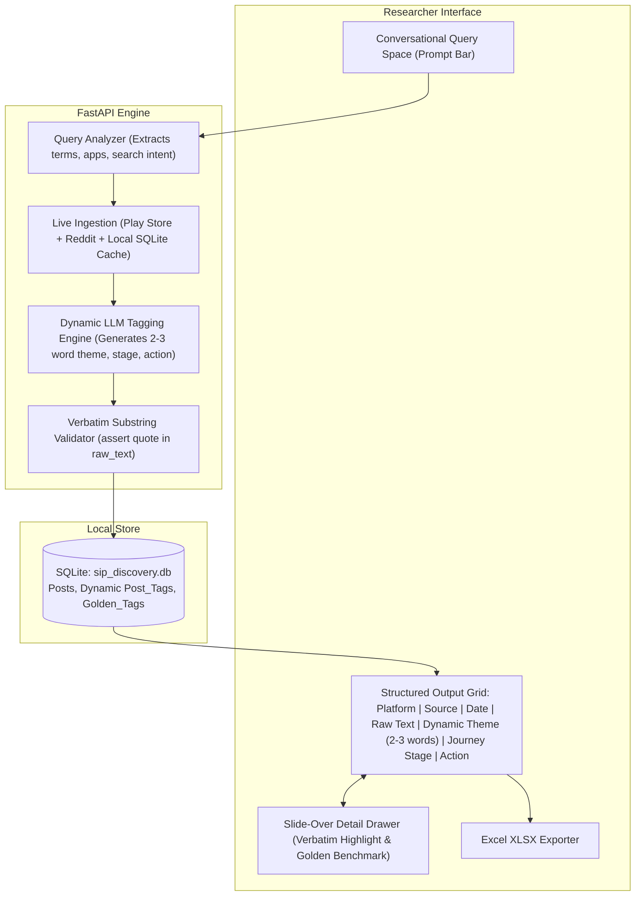

# Technical Architecture: SIP & Fintech Investor Discovery Engine

## 1. System Overview & Conversational Architecture

The SIP Discovery Engine is an open-ended research workbench designed for Product Managers studying investor behavior across all Indian fintech platforms (Groww, Zerodha Coin, Angel One, INDmoney, Kuvera, Paytm Money).

Rather than forcing research into pre-determined taxonomies or rigid categorical filters, the system operates as a **prompt-driven discovery engine**:
1. **Researcher Prompt**: The PM enters an open-ended research question into a clean query space (similar to ChatGPT or Gemini).
2. **Query Analysis**: An LLM decomposes the research question into search intents, target investment platforms, and semantic search keywords.
3. **Targeted Ingestion**: Free public scrapers query Google Play Store (app reviews) and Reddit (`r/IndiaInvestments`, `r/Mutualfunds`) using the generated search parameters.
4. **Dynamic Comment-Dependent Tagging**: An LLM reads each raw comment and dynamically tags:
   * **Platform**: e.g., Groww, Zerodha, Angel One, General MF.
   * **Source**: Google Play Store, Reddit, YouTube.
   * **Date**: Original publication timestamp.
   * **Raw Comment**: Full verbatim user comment.
   * **Theme**: Dynamic **2–3 word tag** describing the core problem or friction, completely derived from the text (not fixed).
   * **Journey Stage**: Dynamic investor stage derived from context (not fixed).
   * **Action Taken**: Dynamic investor action (not fixed).
   * **Evidence Quote**: Exact verbatim substring grounding the tags.



---

## 2. Ingestion Engine & Free Data Sources

### 2.1 Multi-App Google Play Store Ingestion
* **Target Platforms**: Groww (`com.nextbillion.groww`), Zerodha Coin (`com.zerodha.coin`), Angel One (`com.msf.angelmobile`), INDmoney (`in.indwealth`), Kuvera (`com.kuvera.app`).
* **Query-Driven Scraping**: When a query is submitted, the LLM generates 3–5 targeted keyword variants (e.g. *"market crash"*, *"loss"*, *"SIP pause"*, *"SOA demat"*) and queries Play Store 1–3 star reviews matching those terms.

### 2.2 Reddit Ingestion
* **Target Subreddits**: `r/IndiaInvestments`, `r/Mutualfunds`, `r/personalfinanceindia`.
* **Execution**: Searches Reddit public feeds using query-aligned terms. If rate-limited, supplements from the authentic public archive.

### 2.3 Privacy & Synthetic Identifiers
* User handles, phone numbers, and emails are stripped (`[REDACTED_USER]`, `[REDACTED_PHONE]`).
* Posts receive synthetic identifiers (e.g., `POST_GROWW_D3A82`).

---

## 3. Dynamic LLM Tagging & Grounding Engine

The LLM enriches each post dynamically without restrictive categorical enums:

```json
{
  "theme": "string (Dynamic 2-3 words tagging the core problem/friction, derived directly from the comment)",
  "journey_stage": "string (Dynamic investor stage inferred from context, e.g. '1st Month Bull Run', 'Year 2 Market Dip', 'KYC Onboarding')",
  "what_they_did": "string (Dynamic action taken, e.g. 'Cancelled SIP', 'Switched to Coin', 'Paused indefinitely', 'Continued despite dip')",
  "who_they_are": "string (Short persona, e.g. 'Salaried beginner, 24yo' or 'Unclear')",
  "evidence_quote": "string (Exact verbatim substring copied word-for-word from raw text)"
}
```

### Grounding & Substring Verification
$$\text{is\_valid} = (\text{evidence\_quote} \in \text{raw\_text})$$
If the model paraphrases or invents a quote, the backend automatically extracts the highest-overlap matching sentence from the raw text to guarantee zero hallucination.

---

## 4. Local Storage Schema (SQLite)

```sql
CREATE TABLE IF NOT EXISTS posts (
    id TEXT PRIMARY KEY,
    platform TEXT NOT NULL,
    source TEXT NOT NULL,
    source_id TEXT NOT NULL,
    raw_text TEXT NOT NULL,
    url TEXT NOT NULL,
    published_at TEXT,
    fetched_at TIMESTAMP DEFAULT CURRENT_TIMESTAMP
);

CREATE TABLE IF NOT EXISTS post_tags (
    post_id TEXT PRIMARY KEY REFERENCES posts(id) ON DELETE CASCADE,
    theme TEXT NOT NULL,                -- Dynamic 2-3 word tag
    journey_stage TEXT NOT NULL,        -- Dynamic stage context
    what_they_did TEXT NOT NULL,        -- Dynamic action
    who_they_are TEXT NOT NULL,
    evidence_quote TEXT NOT NULL,
    model_name TEXT NOT NULL,
    tagged_at TIMESTAMP DEFAULT CURRENT_TIMESTAMP
);

CREATE TABLE IF NOT EXISTS golden_tags (
    id INTEGER PRIMARY KEY AUTOINCREMENT,
    post_id TEXT UNIQUE REFERENCES posts(id) ON DELETE CASCADE,
    theme TEXT NOT NULL,
    journey_stage TEXT NOT NULL,
    what_they_did TEXT NOT NULL,
    who_they_are TEXT NOT NULL,
    evidence_quote TEXT,
    notes TEXT,
    updated_at TIMESTAMP DEFAULT CURRENT_TIMESTAMP
);

CREATE VIRTUAL TABLE IF NOT EXISTS posts_fts USING fts5(
    post_id UNINDEXED,
    platform,
    raw_text
);
```

---

## 5. Frontend Architecture

* **Primary Screen**:
  * Top Research Bias Caution Banner.
  * **Central Prompt Bar**: Clean, elegant search/prompt space (like ChatGPT/Gemini) with example prompts for investor behavior research.
  * Real-Time Metrics: Ingested Posts, Golden Verified Benchmarks, Top Dynamic Themes.
  * **Structured Data Grid**:
    * Columns: Status, Platform, Source, Date, Raw Comment, Dynamic Theme (2–3 words), Dynamic Journey Stage, Action Taken.
    * Removed static categorical dropdown filters under query bar (`theme`, `stage`, `action`, `fixer`).
  * **Excel Export**: Single-click `.xlsx` download.
* **Slide-Over Detail Drawer**:
  * Full raw text with verbatim evidence highlighted in yellow/amber `<mark>`.
  * Clickable link to the original public post.
  * Golden Benchmark editor allowing PMs to refine the dynamic tags and add research rationale.
