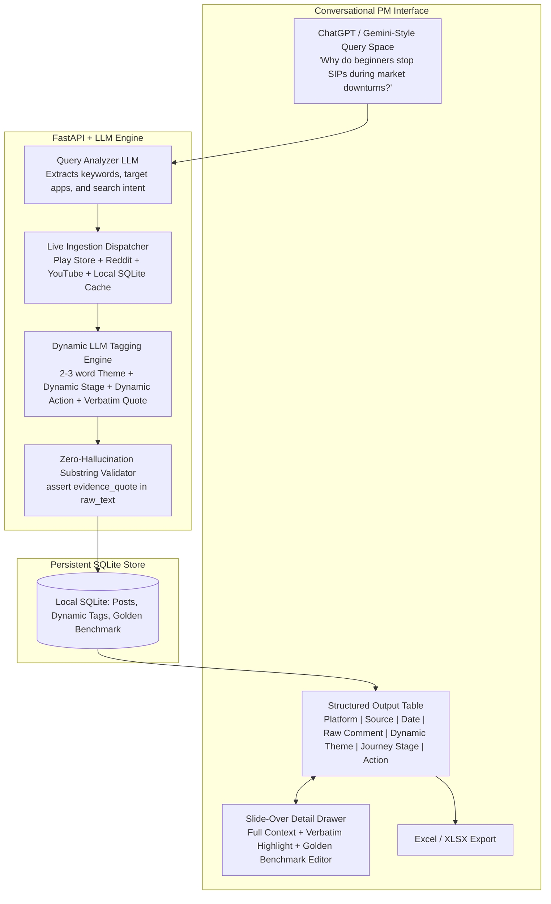

# SIP & Fintech Investor Discovery Engine: Architecture & Implementation Plan

## Executive Summary
The **SIP Discovery Engine** is an open-ended, AI-powered qualitative research workbench for Product Managers, UX researchers, and growth leads studying investor behavior across **all Indian mutual fund & fintech investment platforms** (e.g., Groww, Zerodha Coin, Angel One, INDmoney, Kuvera, Paytm Money, Navi).

Rather than being biased toward a single pre-determined problem (such as mandate bounce) or locked into rigid categorical dropdowns, the system features a **conversational, prompt-driven research interface** inspired by modern LLM assistants (ChatGPT / Gemini / Perplexity):

1. **Conversational Query Entry**: The researcher enters any open-ended research question (e.g., *"Why do beginners stop SIPs during market downturns?"*, *"What friction occurs when moving from Groww to Zerodha Coin?"*, or *"Why do users cancel instead of pause?"*).
2. **Query Analysis & Live Ingestion**: An LLM reads and analyzes the researcher's prompt, decomposes it into search intents and semantic keywords, and triggers targeted live ingestion across free public sources (Play Store reviews, Reddit discussions, YouTube comments).
3. **Dynamic, Comment-Dependent Tagging**: Instead of forcing comments into fixed, predetermined taxonomies, an LLM dynamically reads each comment and extracts:
   * **Platform**: Groww, Zerodha Coin, Angel One, INDmoney, Kuvera, or General MF.
   * **Source**: Google Play Store, Reddit, etc.
   * **Date**: Original publication timestamp.
   * **Raw Comment**: Full verbatim user comment.
   * **Theme**: Dynamic **2–3 word summary** of the exact problem or friction (completely open-ended, derived directly from the text).
   * **Journey Stage**: Dynamic investor stage derived from context (e.g., *Onboarding / KYC*, *1st Month Bull Run*, *Year 2 Market Dip*, *Tax Season ELSS*, *Platform Migration*, *Exit / Withdrawal*).
   * **Action Taken**: Dynamic action taken by the investor (e.g., *Cancelled SIP*, *Switched to Coin*, *Paused indefinitely*, *Continued despite dip*, *Withdrew capital*).
   * **Evidence Quote**: Exact verbatim substring from the raw comment grounding the tags (Zero-hallucination guarantee).
4. **Structured Research Output**: The researcher receives a clean, interactive data grid displaying the enriched comments, a slide-over detail panel with verbatim quote highlighting in amber `<mark>`, Golden Benchmark overrides, and one-click Excel export.

---

## 1. System Architecture: Prompt-Driven Research & Dynamic Ingestion

---

## 2. Ingestion & Retrieval Pipeline

### 2.1 Query-Driven Ingestion
When a researcher submits a question:
1. **Query Analysis**:
   * Identifies target platforms mentioned (e.g., "Groww", "Zerodha", or all platforms).
   * Generates tailored search keywords for public APIs (e.g., query *"Why do users stop SIP during market fall?"* $\rightarrow$ keywords: `["market fall", "loss", "red portfolio", "stop SIP", "bear market"]`).
2. **Multi-Source Fetching**:
   * **Google Play Store**: Queries targeted apps using `google-play-scraper` with query-aligned keywords across 1–3 star friction reviews.
   * **Reddit Discussions**: Queries `r/IndiaInvestments`, `r/Mutualfunds`, and `r/personalfinanceindia` for active user threads.
3. **Local Cache Augmentation**:
   * Searches existing accumulated posts in SQLite (`sip_discovery.db`) and supplements them with fresh live posts.

### 2.2 Dynamic Tagging Schema (No Rigid Buckets)

| Field | Nature | Generation Logic | Example Values |
| :--- | :--- | :--- | :--- |
| **Platform** | Categorical | Extracted from metadata or text | `Groww`, `Zerodha`, `AngelOne`, `INDmoney`, `Kuvera`, `General MF` |
| **Source** | System | Channel origin | `Play Store`, `Reddit`, `YouTube` |
| **Date** | System | Publication timestamp | `2026-10-18` |
| **Raw Comment** | Text | Full anonymized user feedback | *"I started SIP in Nifty 50 3 months back. Now market is down 5% and I panicked and cancelled..."* |
| **Theme** | **Dynamic (2–3 words)** | LLM tags the specific problem/topic directly from comment content | `Market dip panic`, `Autopay bounce charge`, `SOA vs Demat switch`, `SIP date mismatch`, `Negative return anxiety` |
| **Journey Stage** | **Dynamic Context** | LLM infers stage from investor's tenure/situation | `1st Month Bull Run`, `Months 2-6 Market Dip`, `Experienced / Year 3`, `Platform Migration`, `KYC Onboarding` |
| **Action Taken** | **Dynamic Action** | Action actually taken or contemplated | `Cancelled SIP`, `Switched to Coin`, `Paused indefinitely`, `Continued investing`, `Withdrew capital` |
| **Evidence Quote** | **Verbatim Substring** | Exact substring from text justifying the tags | *"panicked and cancelled my SIP"* |

---

## 3. UI Design Specification

* **Initial Launch Screen (Clutter-Free)**:
  * Persistent Research Complainant Bias Caution Banner.
  * Real-Time Metrics Strip: Ingested Public Posts, Golden Benchmark Verified count, Reliability (Cohen's κ), and Top Platform Volume.
  * **Central Prompt Space**: Prominent query bar (inspired by ChatGPT / Gemini) with suggested research prompt chips.
  * **Ready for Discovery Starter Workspace**: 3 interactive investigation cards (*SIP Cancellation Anxiety*, *Mandate & Bounce Failures*, *Broker Migration & Demat*) guiding new researchers.
  * **Hidden on Launch**: The large 100-comment data grid is hidden initially to prevent visual clutter and maintain a fast, conversational workflow.
* **Active Research Screen (Prompt-Revealed)**:
  * **Structured Data Grid**: Reveals dynamically once an inquiry is submitted.
    * Columns: Status (Golden vs. AI Tagged), Platform, Source, Date, Raw Comment, Dynamic Theme (2–3 words), Dynamic Journey Stage, Action Taken.
    * Status Indicator: `⚡ Hybrid RAG Active` combining semantic vectors and lexical search via RRF.
  * **Excel Export Button**: Single-click multi-tab `.xlsx` download.
* **Slide-Over Detail Drawer**:
  * Full raw text with verbatim evidence highlighted in yellow/amber `<mark>`.
  * Clickable link to the original post.
  * Golden Benchmark editor allowing PMs to refine the dynamic tags and add research rationale.
* **Evaluation Dashboard Modal**:
  * Cohen's Kappa score gauge with Landis & Koch interpretation.
  * Interactive Theme Confusion Matrix with diagonal match highlighting.
  * Disagreement Inspector with side-by-side comparison cards and one-click resolution.

---

## 4. Implementation Roadmap

### Phase 1: Dynamic Prompt-Driven Engine & Clean UI (Completed)
* Implemented query analyzer LLM that interprets free-form research questions and extracts search parameters.
* Refactored LLM tagger to dynamically generate 2–3 word themes, dynamic journey stages, and actions directly from raw comments.
* Redesigned UI to feature central prompt space, removing static dropdown filters.
* Updated table and slide-over detail panel to present dynamic tags with verbatim quote verification.
* Ensured Excel export reflects the dynamic schema.

### Phase 2: Multi-Platform Ingestion & YouTube Comments (Completed)
* Expanded scrapers to Groww, Zerodha Coin, Angel One, INDmoney, and Paytm Money.
* Integrated real-time YouTube comment downloader across Indian personal finance creators with fallback archive.
* Added multi-stage token deduplication (SHA-256 + fuzzy Jaccard token overlap) and spam filtering.
* Built Indian Fintech Hinglish glossary and contextual tag enrichment.

### Phase 3: Semantic Hybrid Retrieval & Golden Benchmark Analytics (Completed)
* Integrated Hybrid RAG combining dense TF-IDF semantic vector similarity with SQLite FTS5 BM25 lexical search via RRF.
* Built full evaluation dashboard computing Cohen's Kappa (κ = 0.665, "Substantial Agreement"), Theme Confusion Matrix, and the Disagreement Inspector.
* Pre-seeded verified Golden Benchmark set and added interactive resolution actions.

### Phase 4: Google Stitch UI Polish & Delivery (Completed)
* Multi-tab executive Excel export (Active Feed, Golden Benchmark, Kappa Metrics).
* Google Stitch design system polish, micro-animations, keyboard accessibility (Escape listener).
* Packaged master launch script (`run.sh`) and comprehensive documentation (`README.md`).

### Phase 5: Production Hardening, Zero-Error Assurance & Vercel Cloud (Completed)
* **Type Safety & Diagnostics**: Full typing with `TypedDict` and broadened text cleaners; resolved Pyright interpreter bindings via `.vscode/settings.json` and `pyrightconfig.json`.
* **Database Resilience**: Configured SQLite WAL mode (`PRAGMA journal_mode=WAL;`), foreign keys, 30s busy timeout, self-healing FTS5 sync check on startup, and SQL `LIKE` fallback on malformed FTS tokens.
* **Conversational UX Refinement**: Replaced the cluttered startup table with the "Ready for Discovery" workspace; reveals the structured feed only upon user query.
* **Automated Test Suite**: 31 unit and integration tests under `tests/` covering API, database, evaluation, exporter, ingestion, retrieval, and tagging.
* **Universal Cross-Platform Launchers**: Created `run.py` (macOS, Windows, Linux) and `run.bat` (Windows).
* **Vercel Cloud Deployment & Cache-Busting**: Configured serverless ASGI request routing and `Cache-Control: no-cache, no-store, must-revalidate` for `index.html` to eliminate stale asset 404s.
